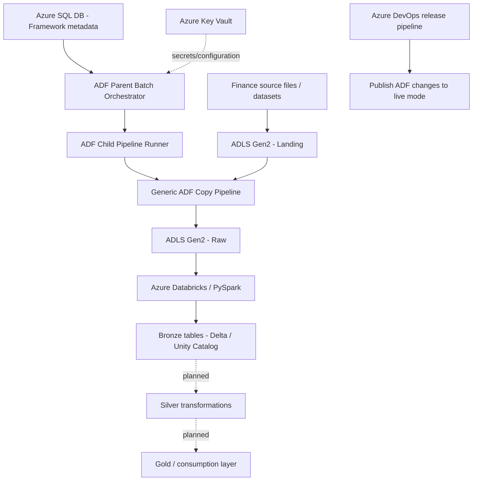

# end_to_end_financial_project
# Finance Data Engineering Platform

A metadata-driven data engineering project built with **Azure Data Factory (ADF), Azure Data Lake Storage Gen2 (ADLS Gen2), Azure Databricks, PySpark, Delta Lake, Unity Catalog, Azure SQL Database, Azure Key Vault, and Azure DevOps**.

The goal is to build a reusable, configuration-driven data platform that ingests finance-related datasets and processes them through a lakehouse architecture. Instead of creating a separate ingestion pipeline for every entity, ADF pipelines read configuration from framework tables and use shared pipeline logic wherever possible.

> **Project status:** In progress. The metadata-driven ADF framework and generic landing-to-raw copy pattern have been developed, and the parameterized Databricks Bronze notebook and Unity Catalog storage setup are in place. Bronze-to-Silver transformations and later layers are planned next.

---

## Table of Contents

- [Project Goals](#project-goals)
- [Architecture](#architecture)
- [Technology Stack](#technology-stack)
- [Data Flow](#data-flow)
- [Metadata-Driven ADF Framework](#metadata-driven-adf-framework)
- [Databricks and Lakehouse Design](#databricks-and-lakehouse-design)
- [Example Data Domains](#example-data-domains)
- [Repository Structure](#repository-structure)
- [Security and Configuration](#security-and-configuration)
- [Current Status and Roadmap](#current-status-and-roadmap)
- [Design Principles](#design-principles)

---

## Project Goals

- Build reusable ingestion pipelines instead of maintaining one pipeline per entity.
- Drive pipeline execution through metadata stored in Azure SQL Database.
- Separate pipeline orchestration from entity-specific configuration.
- Land source files in ADLS Gen2 and process them using a Bronze/Silver/Gold lakehouse pattern.
- Use Databricks and PySpark for scalable data transformations.
- Govern lakehouse data using Unity Catalog and managed storage locations.
- Keep credentials and sensitive configuration out of source code.
- Use Azure DevOps to publish ADF changes from development to live mode.

## Architecture



The diagram distinguishes the implemented foundation from planned processing layers. The exact source connectivity and secret references depend on the configuration used in each environment.

## Technology Stack

| Technology | Role |
|---|---|
| Azure Data Factory (ADF) | Metadata-driven orchestration and reusable ingestion pipelines |
| Azure Data Lake Storage Gen2 | Landing and raw file storage, with storage used by the lakehouse |
| Azure SQL Database | Framework tables containing batch and pipeline configuration |
| Azure Databricks | Distributed processing and notebook execution |
| PySpark / Apache Spark | Data transformation and processing |
| Delta Lake | Lakehouse table format for transactional data processing |
| Unity Catalog | Data governance and catalog/schema/table organization |
| Azure Key Vault | Intended location for secrets and sensitive configuration |
| Azure DevOps | Source-controlled deployment/release workflow for publishing ADF changes |

## Data Flow

### 1. Source to Landing

Source files are placed in the **Landing** area of ADLS Gen2. The landing area acts as the initial file-arrival zone before the ingestion framework copies data into the raw area.

### 2. Metadata-driven orchestration

The ADF parent orchestrator reads batch configuration from framework tables in Azure SQL Database. The metadata identifies the work to run and supplies the values needed by the reusable pipelines.

### 3. Generic Landing-to-Raw copy

The generic copy pipeline uses parameters such as:

- `plp_source_container_name`
- `plp_target_container_name`
- `plp_source_path`
- `plp_sink_path`
- `plp_source_filename`
- `plp_sink_filename`

The pipeline uses **BinarySource** and **BinarySink** for file-level copying, allowing the same copy pattern to handle different file formats without interpreting or transforming their contents during this stage.

### 4. Databricks Bronze processing

A parameterized Databricks notebook reads the relevant raw data and creates Bronze tables. The goal is to reuse the notebook across entities by passing configuration such as the entity, source path, target table/location, and other required runtime parameters.

The workspace is configured with Unity Catalog, a storage credential, an external location, and catalog/schema storage settings for ADLS Gen2.

### 5. Silver and later layers

The next stage is to implement Bronze-to-Silver processing. Shared transformation utilities can be reused, while entity-specific business rules can remain separate where datasets require different logic. Gold/consumption models can be added after the Silver layer is established.

---

## Metadata-Driven ADF Framework

The framework separates **what should run** (metadata) from **how it runs** (reusable pipelines).

### Main components

| Component | Responsibility |
|---|---|
| Framework tables in Azure SQL DB | Store batch and pipeline parameters as rows/columns rather than embedding all configuration in pipeline definitions |
| `pl_generic_parent_batch_orchestrator` | Acts as the entry point for a batch and retrieves the corresponding configuration |
| `pl_generic_child_pipeline_runner` | Coordinates execution of a configured child pipeline |
| `pl_generic_copy_landing_to_raw` | Performs reusable binary file copying from Landing to Raw |
| ADF Web activity | Used in the child-runner flow to call the ADF management API to start a child pipeline run |

### How a batch runs

1. A batch configuration is maintained in the framework tables, including the required pipeline and file/path parameters.
2. The parent orchestrator receives a batch name and retrieves its configuration from Azure SQL Database.
3. The framework uses that configuration to determine the pipeline work to execute.
4. The child runner starts the configured child pipeline through the ADF management API.
5. The generic copy pipeline uses the supplied parameters to copy the configured file from Landing to Raw.
6. Databricks processing can then consume the raw data using notebook parameters.

**Why this design?** Adding a new entity should primarily require configuration and, where necessary, entity-specific transformation logic. It should not require duplicating the entire ingestion pipeline for every dataset.

> Implementation note: API authentication, live-pipeline availability, dynamic parameter binding, and file-path expressions must be validated in the target environment. A successful design in development should not be treated as production-ready until these cases and failure paths have been tested.

## Databricks and Lakehouse Design

### Unity Catalog setup

The Databricks data-governance and storage setup includes:

- A Unity Catalog storage credential using the Azure Databricks Access Connector / managed identity approach.
- An external location connecting Unity Catalog to the relevant ADLS Gen2 path.
- A finance catalog and Bronze schema.
- A configured managed storage location so managed table data can be stored in the intended ADLS Gen2 location.

### Medallion approach

| Layer | Purpose | Status |
|---|---|---|
| Landing | Initial arrival of source files | In use in the ingestion design |
| Raw | File-level copy of source data, preserving the source representation | Generic copy pattern developed |
| Bronze | Initial tables created from raw data with limited standardization | Parameterized notebook and setup completed |
| Silver | Cleaned, validated, deduplicated, and conformed data; entity-specific business rules where needed | Planned / next implementation stage |
| Gold | Curated business-ready datasets and aggregates | Future extension |

The Silver layer is not assumed to be identical for every entity. Common operations such as type casting, null handling, audit columns, and reusable validation functions can be shared, while transformations unique to customers, transactions, accounts, merchants, or fraud events can be configured or implemented separately.

## Example Data Domains

The project is designed to accommodate these entities:

- **Customers**
- **Transactions**
- **Accounts**
- **Merchants**
- **Fraud Events**

These are the intended project data domains. Each entity can have its own source file and transformation requirements while reusing the common ingestion and orchestration framework.

## Repository Structure

A possible repository structure as the project grows:

```text
finance-data-engineering/
├── README.md
├── adf/
│   ├── pipelines/
│   │   ├── pl_generic_parent_batch_orchestrator.json
│   │   ├── pl_generic_child_pipeline_runner.json
│   │   └── pl_generic_copy_landing_to_raw.json
│   ├── datasets/
│   ├── linkedServices/
│   └── triggers/
├── databricks/
│   ├── notebooks/
│   │   ├── raw_bronze.py
│   │   └── bronze_silver/             # planned
│   └── transformations/               # reusable logic as it is added
├── sql/
│   ├── framework_tables/
│   └── seed_metadata/
├── docs/
│   ├── architecture.md
│   └── runbook.md
└── .gitignore
```

This is a suggested layout, not a claim that all these folders or exported files already exist. Adjust it to match the actual repository and exported ADF/Databricks artifacts.

## Security and Configuration

- Do not commit passwords, access keys, tokens, connection strings, tenant secrets, or other credentials.
- Use Azure Key Vault or the relevant managed identity-based integration for secrets and access where configured.
- Prefer managed identity and least-privilege access for Azure resources where supported.
- Keep environment-specific paths, resource names, and runtime parameters configurable.
- Review exported ADF JSON and notebook files before committing to ensure secrets or sensitive identifiers are not included.

## Current Status and Roadmap

### Implemented foundation

- [x] Created the core Azure resources for the project, including ADLS Gen2, ADF, Databricks, Azure SQL Database, and Key Vault.
- [x] Created a generic binary-copy pipeline for Landing-to-Raw ingestion.
- [x] Created framework tables in Azure SQL Database to hold batch and pipeline parameters.
- [x] Built the parent batch orchestrator and child pipeline runner structure.
- [x] Set up the Databricks Unity Catalog storage credential and external location.
- [x] Configured the finance catalog/schema storage setup for ADLS Gen2 managed storage.
- [x] Completed the initial parameterized Bronze notebook.

### Next steps

- [ ] Validate end-to-end execution of metadata-driven batches, including authentication, parameter passing, and error handling.
- [ ] Build the Bronze-to-Silver transformation approach with reusable common logic and entity-specific rules.
- [ ] Add data-quality checks, duplicate handling, and schema validation.
- [ ] Add reliable run logging, audit columns, and batch-level status tracking.
- [ ] Implement incremental processing and watermarking where the source data supports it.
- [ ] Build Gold/consumption tables and business-level metrics.
- [ ] Add operational monitoring, retry/recovery patterns, and deployment documentation.
- [ ] Add automated tests and a repeatable release process.

## Design Principles

1. **Metadata over duplication:** store batch-specific configuration in framework tables and reuse common pipelines.
2. **Parameterization:** pass source, destination, entity, and execution values at runtime.
3. **Layer separation:** keep ingestion, raw storage, and transformation responsibilities distinct.
4. **Reuse without over-generalization:** share common transformations, but preserve entity-specific business rules where appropriate.
5. **Governed storage:** organize tables through Unity Catalog and configure storage deliberately.
6. **Secure by default:** keep secrets out of Git and use managed identities and least-privilege access where possible.
7. **Incremental delivery:** validate each layer end to end before adding more complexity.

---

## Summary

This project is building a reusable finance data platform on Azure. ADF handles metadata-driven orchestration and generic file ingestion, ADLS Gen2 provides the storage foundation, and Databricks/PySpark processes the data into a governed lakehouse. The current milestone is the ingestion framework and Bronze layer; Silver transformations, data-quality controls, and curated Gold datasets are the next stages.
